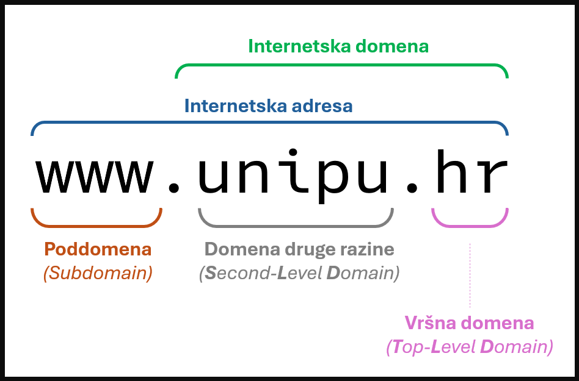

### DNS Mapper

Projekt iz kolegija Web aplikacije na fakultetu informatike u Puli.

#### Opis aplikacije

Aplikacija iz više otvorenih izvora koristiti besplatne API servise za povlačenje informacija o DNS infrastrukturi organizacije. Recimo za unipu.hr će izvući sve subdomene i sastaviti listu internetskih adresa koje koristi sveučilište. Zatim će prevesti sve internetske adrese u IP adrese i obogatiti će sve IP adrese sa osnovnim podacima (telekom, zemlja, autonomni sustav). Korisnik sustava onda naknadno može mijenjati sadržaj, ručno dopuniti komentare i slično.

#### Opis modula

backend/**get_subdomains.js** - Ulazna vrijednost je internetska domena, a izlazna vrijednost je lista internetskih adresa koje pripadaju istoj domeni iz pasivnih DNS zapisa.

backend/**get_ips.js** - Ulazna vrijednost je internetska adresa, a izlazna vrijednost je odgovarajuća IP adresa u javnom internetskom prostoru.

**DODATAK A**: Važno za razumijevanje internetskih adresa

Za projekt je vrlo važno jasno razlikovati komponente internetske adrese. Često miješamo internetsku adresu sa domenom.

